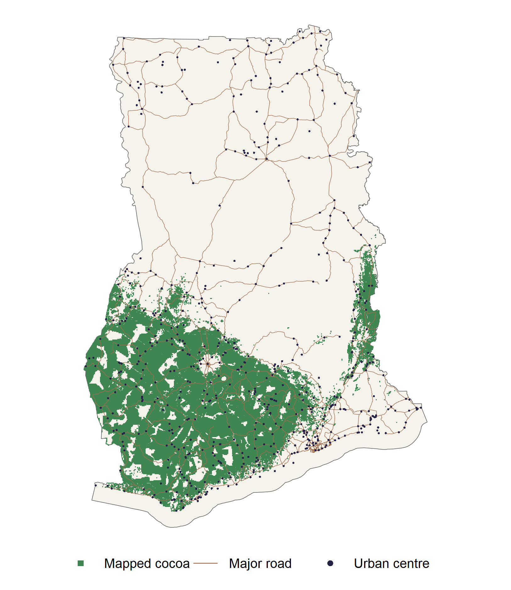
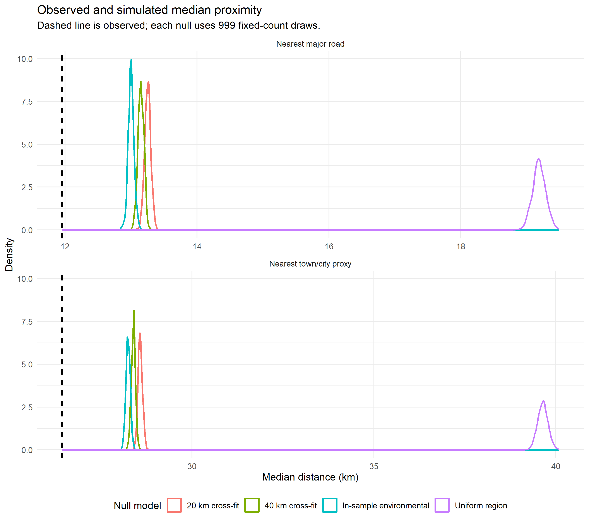
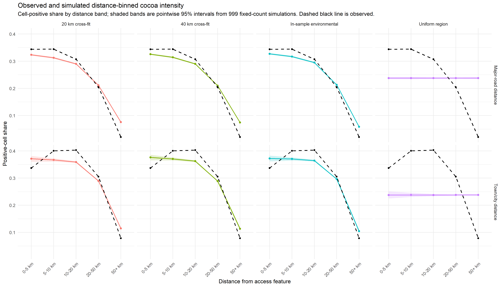
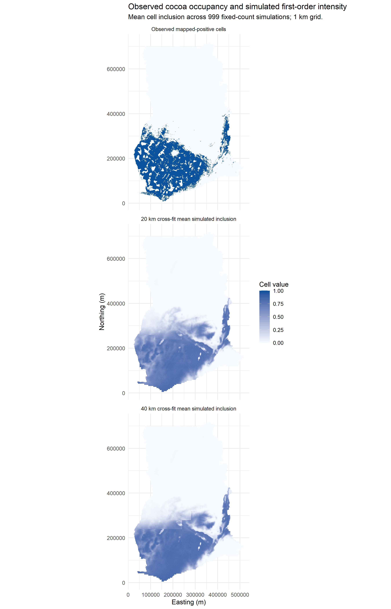
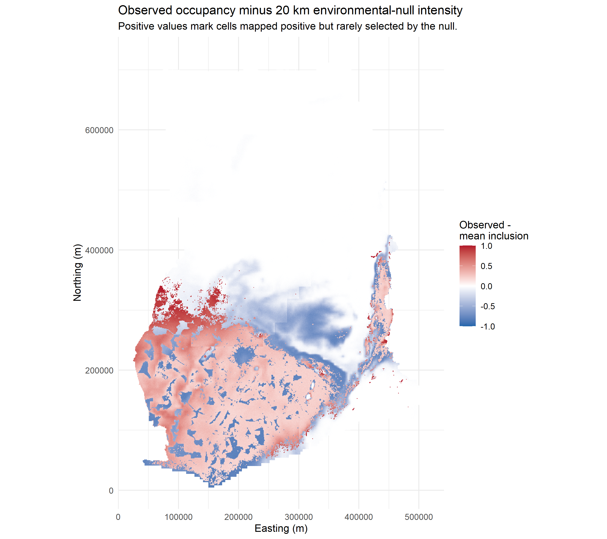
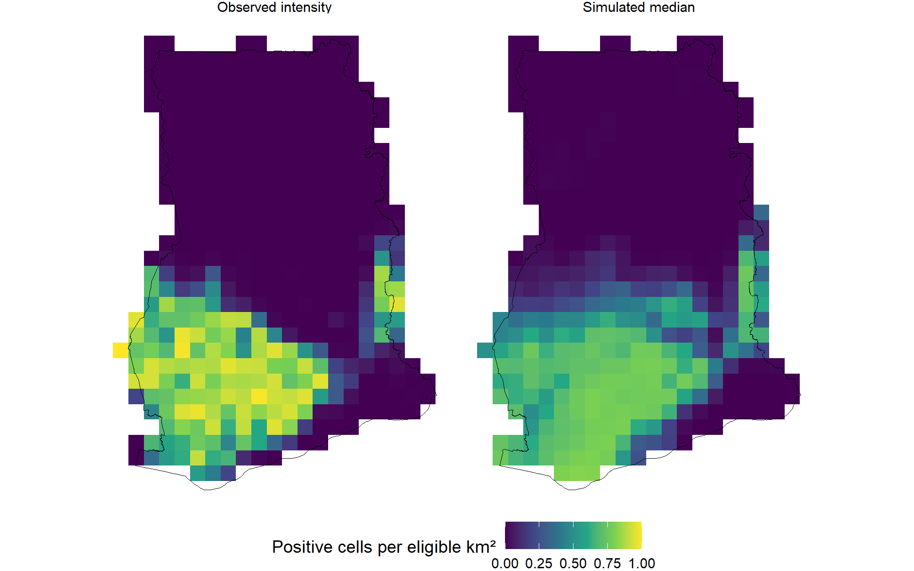
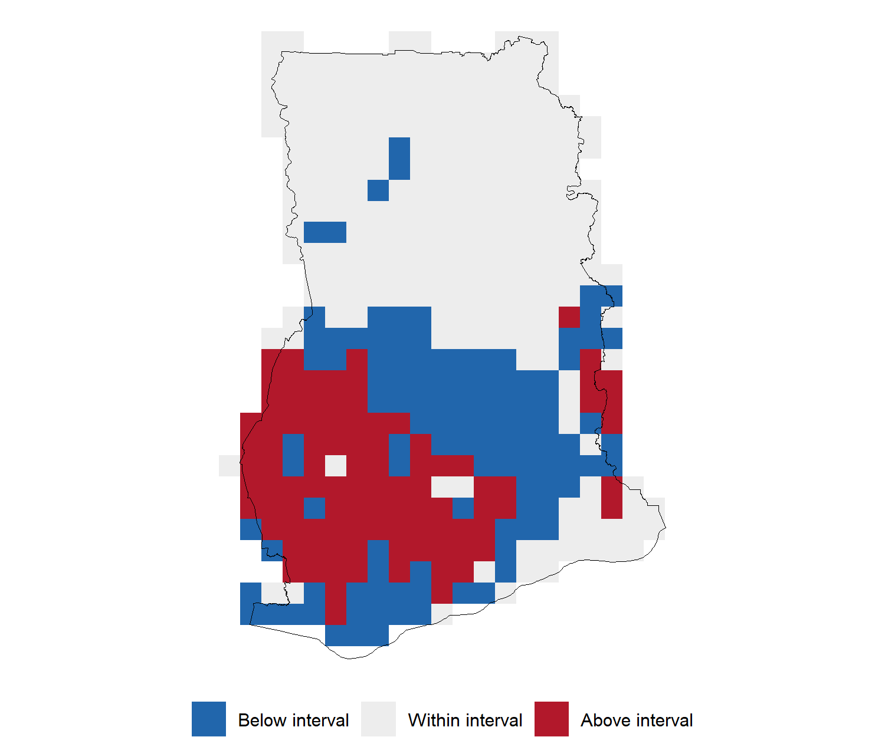

# Cocoa Farming and Access to Markets in Ghana

This project asks whether mapped cocoa-growing areas in Ghana are closer to major roads and urban centres than expected given their climate and elevation. Road proximity is the primary measure of accessibility. Urban-centre proximity is a secondary proxy for potential market access. The study examines first-order spatial intensity, meaning how the expected occurrence of mapped cocoa varies across locations.

The directional hypothesis is that the median distance to the nearest major road is shorter for mapped cocoa cells than for simulated cells drawn according to the environmental baseline. The secondary comparison asks the same question for the nearest urban centre. The proximity statistic is computed separately for roads and urban centres, so it measures each relationship on its own.

## Final project requirements

The [PPOL 6805 / DSAN 6750 final project brief](https://jjacobs.me/ppol6805/final-project.html) is addressed in the [Quarto manuscript](manuscript/manuscript.qmd) and the sections below.

Download and open the [rendered HTML manuscript](outputs/index.html) in a browser. The [simulation results](outputs/tables/ghana_simulation_summary.csv), [simulation checks](outputs/tables/ghana_simulation_qa.csv), [distance-band results](outputs/tables/ghana_distance_binned_intensity_summary.csv), [quadrat results](outputs/tables/ghana_quadrat_intensity.csv), and [cross-validation summary](outputs/tables/ghana_environmental_cv_summary.csv) are available as CSVs.

| Course requirement | Project evidence |
| --- | --- |
| Application area | Agricultural geography and rural infrastructure in Ghana |
| Spatial hypothesis and order | A directional first-order hypothesis about cocoa occupancy relative to roads, with settlement proximity as a secondary comparison |
| Initial evidence | National overlay of mapped cocoa, major roads and urban centres |
| Formal hypothesis evaluation | Four null baselines with 999 patterns each, a primary lower-tail road-distance test, and observed-versus-simulated first-order intensity by distance band and geographic quadrat |
| Initial conclusion and roadmap | Provisional inference about mapped proximity and a sequence of data and model checks below |
| Quarto Manuscript format | [Manuscript source](manuscript/manuscript.qmd) and [project configuration](manuscript/_quarto.yml) |

## Data and sources

| Input | Role in the analysis | Source |
| --- | --- | --- |
| Thresholded cocoa map | `cocoa_map_th_065.tif`. Approximately 10 m satellite-derived cocoa extent for Ghana and Côte d'Ivoire, based on imagery from around 2019–2021. The workflow uses the 0.65-threshold raster. | CC BY 4.0, [ETH Zurich Research Collection](https://doi.org/10.3929/ethz-b-000654400), [Kalischek et al.](https://doi.org/10.1038/s43016-023-00751-8) |
| Major roads | `ghana.gpkg`, layer `gis_osm_roads_free`. Retain motorway, trunk, primary and secondary line features in the working boundary. | November 9, 2026 OSM snapshot via [Geofabrik Ghana](https://download.geofabrik.de/africa/ghana.html), [OpenStreetMap contributors and ODbL](https://www.openstreetmap.org/copyright) |
| Urban centres | `ghana.gpkg`, layer `gis_osm_places_free`. Retain city, town and national-capital points within the working boundary. | Same dated Geofabrik extract |
| Study boundary | `ghana.gpkg`, layer `gis_osm_adminareas_a_free`. Use the national feature named Ghana as the working boundary. | Same dated Geofabrik extract |
| Annual mean temperature (BIO1) | `wc2.1_2.5m_bio_1.tif`. The model converts stored tenths of a degree Celsius to degrees Celsius. | [WorldClim 2.1](https://www.worldclim.org/data/worldclim21.html), 1970–2000 normals |
| Annual precipitation (BIO12) | `wc2.1_2.5m_bio_12.tif`. The model uses `log1p` of precipitation in millimetres. | [WorldClim 2.1](https://www.worldclim.org/data/worldclim21.html), 1970–2000 normals |
| Elevation | `wc2.1_2.5m_elev.tif`. SRTM-derived elevation in metres. All three WorldClim layers have 2.5 arc-minute source resolution, roughly 4.5 km in Ghana. | [WorldClim 2.1](https://www.worldclim.org/data/worldclim21.html) |

The national run used 6,229 major-road line features and 577 urban-centre points after filtering the Geofabrik extract. Multiple line features can belong to the same road. The [data manifest](data/manifest.csv) records input filenames, versions, licences and checksums.

## Methodology

Under the primary null, the locations of a fixed number of cocoa-positive cells follow sampling weights estimated from temperature, precipitation and elevation. The directional alternative predicts a smaller median road distance than this baseline generates. The analysis concerns first-order intensity, the expected number of occupied cells per unit area. It evaluates accessibility gradients and geographic occupancy without requiring a pairwise correlation function.

1. **Align the layers on a 1 km grid.** The workflow uses the Ghana National Grid (EPSG:2136) and converts projection units to metres for reporting. Eligible cells fall inside the working Ghana boundary and the cocoa raster coverage mask and have complete environmental predictors. Each cell with mapped cocoa contributes one observation at its centre. The threshold raster is reprojected using mean aggregation, and a cell is marked positive when the resulting value is greater than zero. WorldClim layers are aligned to the same grid by bilinear resampling. The workflow treats NaN within the raster coverage mask as no mapped cocoa, an assumption awaiting provider confirmation.
2. **Measure proximity.** Compute the straight-line distance from each eligible cell centre to the nearest major road and the nearest qualifying urban centre. The primary statistic is median road distance across cocoa-positive cells. Median urban-centre distance is secondary.
3. **Estimate an environmental baseline.** Fit a binomial generalized additive model with smooth terms for mean temperature, log-transformed annual precipitation and elevation. The primary model groups 20 km spatial blocks into five geographic folds using k-means on block coordinates and predicts each fold using a model fitted on the other four. The resulting scores weight how often cells are selected for simulations. Road and settlement distances are excluded from the model.
4. **Simulate and compare.** Generate 999 patterns per baseline, drawing 57,131 distinct cells from the same 240,294 eligible locations on every draw. This holds the overall amount of mapped occupancy fixed so the comparison isolates where positive cells fall. Compare the primary baseline with a 40 km block design, an environmental model fitted to all eligible cells, and uniform sampling over eligible cells. The corrected lower-tail Monte Carlo p-value is (1 + simulated medians at or below the observed median) / 1000. Maps compare observed occupancy with simulated inclusion frequency. An exploratory distance profile compares observed and simulated shares across distance bands with pointwise 95% simulation intervals.
5. **Compare geographic intensity.** Assign eligible cell centres to fixed 25 km quadrats aligned to the Ghana National Grid. Calculate observed and simulated intensity as the count of occupied cells divided by eligible grid area in square kilometres. Apply the same estimator to all 999 primary-baseline patterns and compare the observed map with simulated medians and pointwise 2.5th and 97.5th percentiles.

The GAM uses additive smooths with basis dimension five and fast REML with term selection. Fold assignment uses seed `20261117`. For each weighted draw, the simulation takes the cells with the largest random keys based on the log weights and independent uniform variates. Simulations use seed `20261118`. The [analysis decisions](docs/decisions.md) record the primary comparison and sensitivity designs.

## Results and interpretation

### Initial evidence



Mapped cocoa is concentrated in southern and southwestern Ghana and along a narrower eastern belt. The overlay shows where cocoa and infrastructure coincide and motivates comparing the overlap with patterns generated using the environmental baseline.

### How much closer is mapped cocoa?



**Figure 1. Distribution of simulated median distances.** Each coloured curve summarizes 999 pattern-level medians. The dashed black line marks the observed median. The top panel uses distance to major roads, and the bottom uses distance to urban centres. The environmental curves sit closer to the observed line than the uniform curve in both panels, showing how much the baseline choice changes the comparison.

Of the 240,294 eligible 1 km cells, 57,131 contained mapped cocoa (23.8%). This is the prevalence of **positive grid cells** in the study window. A cell contributes equally whether it contains a small cocoa patch or extensive cultivation, so the percentage cannot be read as the share of Ghana's land planted with cocoa.

| Comparison baseline | Major road, simulated median (95% simulation interval), km | Urban centre, simulated median (95% simulation interval), km |
| --- | ---: | ---: |
| **Observed median** | **11.96** | **26.43** |
| Environmental model, 20 km spatial blocks (primary) | 13.25 (13.16-13.34) | 28.58 (28.46-28.70) |
| Environmental model, 40 km spatial blocks | 13.15 (13.06-13.23) | 28.39 (28.28-28.50) |
| Environmental model fitted to all cells | 13.00 (12.92-13.09) | 28.24 (28.13-28.36) |
| Uniform sampling over eligible cells | 19.19 (19.00-19.38) | 39.64 (39.37-39.93) |

Under the primary model, the observed median was **1.30 km shorter for major roads (9.8%)** and **2.15 km shorter for urban centres (7.5%)**, relative to the simulated medians. The direction persisted across the three environmental specifications. The gaps were much larger under uniform sampling, at 7.23 km for roads and 13.21 km for urban centres. Weighting simulated locations by climate and elevation therefore brings the predicted pattern substantially closer to the observed one. The remaining gaps indicate that these environmental predictors alone leave some of the observed proximity unexplained.

For each of the eight comparisons, zero of 999 simulated medians were at or below the observed median, yielding a corrected one-sided Monte Carlo p-value of **0.001**, the smallest value this simulation design can report. Each interval summarizes the middle 95% of simulated medians under its fitted baseline. Uncertainty from cocoa classification, the extent of eligible land, and model fitting is outside those intervals.

### Where along the distance gradient do the differences occur?



**Figure 2. Cocoa occupancy across five distance bands.** The dashed black line shows the observed share of positive cells in each band. Each coloured line shows the median simulated share, with a shaded 95% interval for that band. Read across the top row for roads and the bottom row for urban centres. The primary 20 km comparison is in the first column.

Each percentage below is the fraction of **all eligible cells in that distance band** that were cocoa-positive or selected in a simulated pattern. The simulated column gives the median across the 999 primary environmental draws. This denominator matters because some distance bands cover much more land than others.

| Distance band | Road observed | Road simulated | Urban centre observed | Urban centre simulated |
| --- | ---: | ---: | ---: | ---: |
| 0-5 km | 34.4% | 32.3% | 33.7% | 37.1% |
| 5-10 km | 34.4% | 31.3% | 40.0% | 36.7% |
| 10-20 km | 30.8% | 29.0% | 40.3% | 35.9% |
| 20-50 km | 20.4% | 21.1% | 30.5% | 28.9% |
| Over 50 km | 2.1% | 7.6% | 7.9% | 11.5% |

The road profile shows more mapped cocoa than the baseline in every band within 20 km and less in both bands beyond 20 km. The biggest percentage-point deficit is beyond 50 km from a major road. The urban-centre pattern is different. Cocoa occupancy is below the baseline within 5 km and beyond 50 km, and above it from 5 to 50 km. The shorter urban-centre median reflects higher occupancy at intermediate distances and lower occupancy in the most remote band. Each band is an exploratory comparison with a pointwise simulation interval. The [Quarto manuscript](manuscript/manuscript.qmd) shows the profiles and the maps of observed occupancy and simulated inclusion.

### Where does the environmental model reproduce the mapped pattern?



**Figure 3. Mapped cocoa and environmental simulation surfaces.** The top map assigns 1 to each cocoa-positive cell and 0 to each eligible cell without mapped cocoa. The middle and bottom maps show how often each cell was selected across 999 simulations. A value of 0.75 means the cell appeared in about three-quarters of draws. Both environmental baselines capture the broad concentration of cocoa in southern and southwestern Ghana and along a narrower stretch of the eastern border. The simulated surfaces are smoother and extend into areas where the observed map shows gaps.



**Figure 4. Cell-level differences from the primary environmental baseline.** Red marks cocoa-positive cells selected relatively infrequently in simulation. Blue marks cells without mapped cocoa that the simulation selected relatively often. For example, a cocoa-positive cell selected in 20% of draws has a residual of +0.80, while a cell with no mapped cocoa selected in 80% of draws has a residual of -0.80. These are descriptive differences. A prominent patch can guide follow-up on land cover, mapping quality or omitted predictors, but its colour alone gives no estimate of a road effect.

### What does the 25 km intensity comparison show?





Both surfaces show high intensity in southern Ghana and along the eastern cocoa belt. Of 440 quadrats with eligible cells, 97 observed intensities were above their pointwise intervals, 112 were below, and 231 were within them. Twenty-nine quadrats had fewer than 100 eligible square kilometres, so their estimates describe a small part of the quadrat. The departure counts describe local model mismatch. The intervals cover each quadrat separately.

### How much confidence should we place in the environmental comparison?

| Spatial block size | Pooled held-out AUC | Mean AUC across evaluable folds | Fold AUC range | Folds with no cocoa-positive cells |
| --- | ---: | ---: | ---: | ---: |
| 20 km | 0.934 | 0.815 | 0.463-0.976 | 1 of 5 |
| 40 km | 0.934 | 0.819 | 0.458-0.987 | 1 of 5 |

AUC measures how well the model ranks cocoa-positive cells above other cells. The pooled score looks strong, but individual folds range from below chance-level ranking (0.5) to near-perfect ranking. Both designs have a fold where AUC is undefined because it contains no positives. Some fits also produced warnings about fitted probabilities near zero or one. The proximity result is consistent across the fitted baselines, with substantial uncertainty about how well those baselines represent environmental geography in individual parts of Ghana.

- **Mapped cocoa and eligible land.** Satellite classification errors can affect both the observed pattern and the environmental weights. Treating NaN as absence inside the coverage mask can turn unmapped cells into apparent absences. The raster bounding box overlaps 99.94% of the provisional OSM polygon by area. This measures overlap with the raster rectangle, so coverage within that rectangle remains subject to the NaN assumption. The workflow also lacks an independent land-cover mask for water and other unsuitable areas.
- **Spatial scale and timing.** WorldClim's roughly 4.5 km input resolution limits the environmental detail available on the 1 km analysis grid. The 1970-2000 climate normals describe long-run conditions, while the November 2026 road snapshot may include roads built after the cocoa imagery was acquired.
- **Access and causality.** Straight-line distances omit road connectivity, road condition and travel time. Mapped towns and cities approximate access to population centres. Estimating access to cocoa buyers would require verified purchasing sites. Historical settlement patterns, land use, and infrastructure placement could all contribute to the observed association. The analysis supports a provisional finding about where mapped cocoa occurs relative to roads and settlements. It leaves the causal effect of roads and residual clustering among cocoa locations open.


## Conclusion and next steps

Mapped cocoa cells were closer to major roads than the primary climate-and-elevation baseline predicted. The secondary urban-centre comparison showed a similar shift in the median, with the largest positive differences in occupancy at intermediate distances. These findings support a provisional first-order association under the fitted baselines. The quadrat results and uneven held-out performance identify places where the environmental baseline warrants further checking.

1. Confirm with the cocoa map provider how to distinguish mapped absence from unknown coverage. Compare the working OSM boundary with an independently validated national boundary and use land-cover data to define eligible land.
2. Refit the models with spatial folds that better represent the cocoa belt, assess held-out calibration, and rerun the simulations using plausible alternative environmental fits and eligibility masks.
3. Gather verified cocoa purchasing locations and road data closer in time to the cocoa imagery. Test whether the proximity finding persists when access is measured by network travel time.

## Reproduce the analysis

Install Quarto with manuscript project support and R 4.6.2, the version in [renv.lock](renv.lock). From the repository root, restore the R environment and acquire the raster inputs.

```sh
Rscript -e "renv::restore()"
Rscript R/02_acquire_data.R
Rscript R/11_acquire_environmental_data.R
```

Use the November 9, 2026 Geofabrik snapshot. The original archive is preserved in the project workspace as `data/raw/ghana-latest-free.gpkg.zip`. Geofabrik's public Ghana download index no longer lists that daily archive. For a fresh checkout on another machine, copy the preserved ZIP or its `ghana.gpkg` member from the original workspace. Extract the GeoPackage into `data/raw/` if needed and compare its SHA-256 with the pinned value in the manifest. On Windows, run `Get-FileHash data/raw/ghana.gpkg -Algorithm SHA256` in PowerShell. Exact reproduction depends on using that verified snapshot. [Geofabrik Ghana download index](https://download.geofabrik.de/africa/ghana.html)

The WorldClim acquisition script refreshes its rows in the manifest with the metadata it observes locally.

```sh
Rscript R/12_ghana_wide_null_model.R
Rscript R/13_ghana_wide_simulations.R
Rscript R/14_ghana_wide_reporting.R
quarto render manuscript --to html
```

Raw inputs are stored under `data/raw/` and generated spatial data under `data/processed/`. Use a fresh checkout for a from-scratch analysis because the model script reuses processed grids. Figures and tables go to `outputs/figures/` and `outputs/tables/`. Git tracks the figures, the five results tables linked above and the HTML manuscript at `outputs/index.html`. The other generated outputs and raw inputs stay local. Source citations are in [references.bib](references.bib).

| Generated table | Contents |
| --- | --- |
| ghana_simulation_summary.csv | Observed medians, simulated median percentiles, effect ratios and Monte Carlo p-values |
| ghana_distance_binned_intensity_summary.csv | Observed and simulated shares and the number of eligible cells in each distance band |
| ghana_environmental_cv_summary.csv | Pooled and fold-level performance summaries for both block sizes |
| ghana_simulation_qa.csv | Number of draws and unique simulation IDs, fixed sample size and checks for finite road and urban-centre statistics |
| ghana_quadrat_intensity.csv | Eligible area, observed intensity and simulation percentiles for each 25 km quadrat |
| ghana_intensity_comparison.csv | Observed occupancy and mean simulated inclusion for each candidate cell |
| ghana_simulation_draws.csv and ghana_distance_binned_intensity_draws.csv | Pattern-level proximity and distance-band summaries |
| cocoa_raster_metadata.csv and ghana_source_coverage_summary.csv | Source raster validation and national boundary overlap |
| ghana_null_model_summary.csv, ghana_environmental_cv_diagnostics.csv and ghana_environmental_model_terms.csv | Model inputs, coverage, held-out diagnostics and smooth-term estimates |
