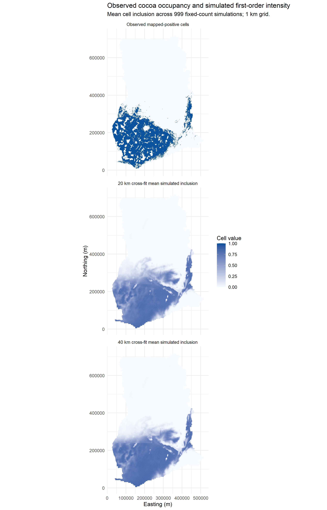
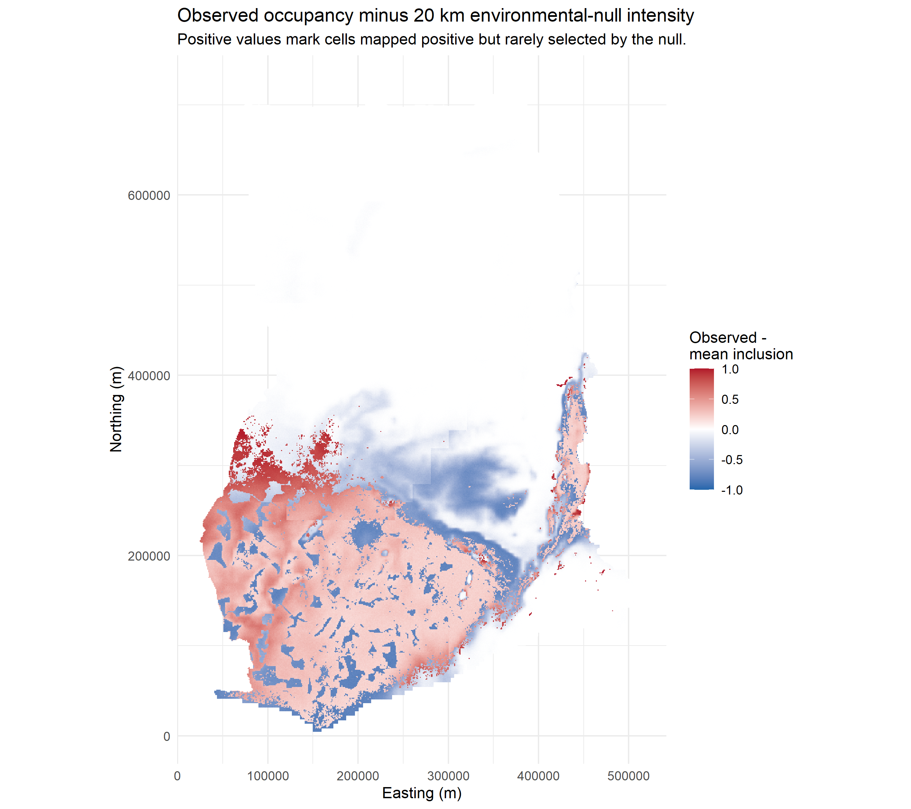
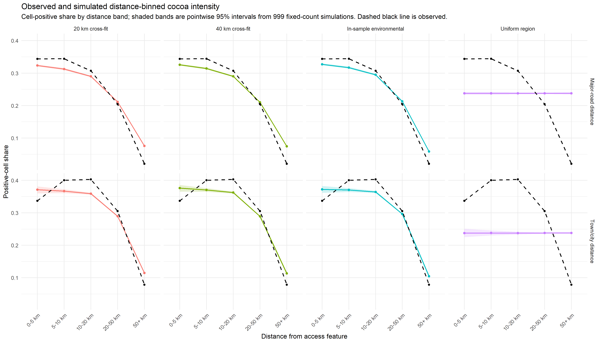

# Summary

This study asks whether mapped cocoa-positive 1 km grid cells in Ghana are closer to major roads and urban-centre proxies than expected under environmental-only and region-uniform spatial nulls. The unit is a grid cell, not a farm. The analysis estimates conditional spatial association; it does not estimate a causal effect of road access.

## Data and methods

The ETH Zurich binary cocoa map [@kalischek2024cocoamap] was overlaid with WorldClim 2.1 annual mean temperature, annual precipitation and SRTM-derived elevation [@fick2017worldclim; @worldclim2021], plus roads and settlements from the Geofabrik Ghana OpenStreetMap snapshot [@geofabrik2026; @OSMcopyright]. The working boundary is the Geofabrik OSM national administrative polygon. It is provisional, not an independently validated official boundary.

The analysis uses a 1 km grid in EPSG:2136 (Accra / Ghana National Grid; Gold Coast feet). The source cocoa raster footprint and complete environmental data define eligibility; cells beyond the cocoa raster extent are excluded. The candidate grid contains 240,294 cells, including 57,131 mapped-positive cells. The OSM boundary geometry measures 251,021.5 km². The cocoa raster bounding box intersects 99.94% of this polygon by area; approximately 143.3 km² lies outside the bounding box. The boundary area is a geometry-derived diagnostic, not an authoritative area statistic.

For the primary environmental null, a binomial GAM using climate and elevation only generated five-fold spatially cross-fitted scores. Whole spatial blocks were grouped into five folds; 20 km blocks are primary, with 40 km as a sensitivity. Road and town distances were excluded as predictors. Each of four nulls generated 999 fixed-count (57,131), no-replacement patterns: 20 km cross-fit, 40 km cross-fit, in-sample environmental GAM, and uniform sampling across eligible candidate cells. Major roads are OSM motorway, trunk, primary and secondary features. The secondary urban-centre proxy comprises OSM city, town and national-capital points; these are not verified cocoa-buying markets.

The primary statistic is the median Euclidean distance to a major road; median distance to an urban-centre proxy is secondary. Lower-tail Monte Carlo p-values use `(1 + number of simulated statistics <= observed) / 1000`. An exploratory functional diagnostic compares the observed positive-cell share with simulated shares across fixed distance bands (0–5, 5–10, 10–20, 20–50 and over 50 km). Its intervals are pointwise, not simultaneous.

## Results

The observed median distance is 11.96 km to a major road and 26.43 km to an urban-centre proxy. Across the 20 km cross-fitted environmental simulations, median road distance is 13.25 km (95% simulation interval 13.16–13.34 km; corrected lower-tail p = 0.001); median town/city distance is 28.58 km (28.46–28.70 km; p = 0.001). Under 40 km cross-fitting, the corresponding medians are 13.15 km (13.06–13.23 km) and 28.39 km (28.28–28.50 km), both p = 0.001. The in-sample environmental and uniform sensitivities also yield longer simulated medians than observed; exact values are in `ghana_simulation_summary.csv`.

| Null model | Statistic | Observed (km) | Simulated median (95% interval, km) | Observed / simulated | Lower-tail p |
|---|---|---:|---:|---:|---:|
| 20 km cross-fit | Major road | 11.96 | 13.25 (13.16–13.34) | 0.90 | 0.001 |
| 20 km cross-fit | Town/city | 26.43 | 28.58 (28.46–28.70) | 0.92 | 0.001 |
| 40 km cross-fit | Major road | 11.96 | 13.15 (13.06–13.23) | 0.91 | 0.001 |
| 40 km cross-fit | Town/city | 26.43 | 28.39 (28.28–28.50) | 0.93 | 0.001 |
| In-sample environmental | Major road | 11.96 | 13.00 (12.92–13.09) | 0.92 | 0.001 |
| In-sample environmental | Town/city | 26.43 | 28.24 (28.13–28.36) | 0.94 | 0.001 |
| Uniform region | Major road | 11.96 | 19.19 (19.00–19.38) | 0.62 | 0.001 |
| Uniform region | Town/city | 26.43 | 39.64 (39.37–39.93) | 0.67 | 0.001 |

In the primary road profile, observed positive-cell shares exceed the 20 km cross-fit simulation envelope in the 0–20 km bands and fall below it in the more distant bands. For the town/city proxy, observed shares are lower in the 0–5 km band, higher in the 5–50 km bands, and lower beyond 50 km, consistent with a shift from the most distant cells toward intermediate distances rather than a uniform increase at every distance. These pointwise band comparisons are exploratory and not a simultaneous test. The median-distance result is the pre-specified directional test. Its minimum p-value of 0.001 is the resolution of 999 draws, not evidence that the probability is zero. All results remain conditional on the cocoa map, eligible cells, boundary and environmental model.

## Cross-validation diagnostics

The pooled out-of-fold AUCs are 0.934 (20 km) and 0.934 (40 km), while mean AUC across folds with both classes is 0.815 and 0.819, respectively. In both block-size designs, one held-out fold has no positive cells, so its AUC is undefined; the remaining fold AUC ranges are 0.463–0.976 and 0.458–0.987. Pooled scores combine predictions from different fold-specific fits and should not be read as a stable measure of national predictive performance. The strong between-fold variation and near-separation in some folds make the environmental scores an uncertain null model, despite finite simulated weights.

## Limitations and next steps

- The project owner instructed that ETH raster NaN be interpreted as no cocoa only within the raster footprint. ETH metadata labels NaN as nodata and does not resolve its meaning; this remains an assumption that may misclassify unknown cells.
- The source raster footprint is not identical to Ghana's boundary, and the area calculation relies on a provisional OSM polygon. Obtain an independently validated boundary and verify the source coverage before making definitive national claims.
- No independent land-cover/land-use mask excludes water, settlements or other unsuitable areas. A uniform-region comparison is a sensitivity, not a valid environmental control.
- The ETH map represents mapped cocoa rather than a farm census. Detection or classification errors can affect both the outcome and the learned environmental weights.
- WorldClim climate normals are for 1970–2000 and coarser than the 1 km analysis grid. OSM roads are a later snapshot; OSM places are incomplete urban-centre proxies, not purchasing markets.
- Fold allocation is geographically imbalanced, including one held-out fold without positive cells at each block size. The GAM also produced warnings about fitted probabilities near zero or one. Re-design cross-validation and assess model-fitting uncertainty before relying on the environmental null.
- Distances are Euclidean proximity, not network travel time. No causal inference or second-order clustering analysis is performed.

The immediate next work is to verify the boundary and NaN semantics, improve the eligible-land mask, and re-evaluate spatial-fold construction and model calibration. The current outputs support a provisional Ghana-wide first-order analysis, not a final validated market-access estimate.

# References

::: {#refs}
:::
