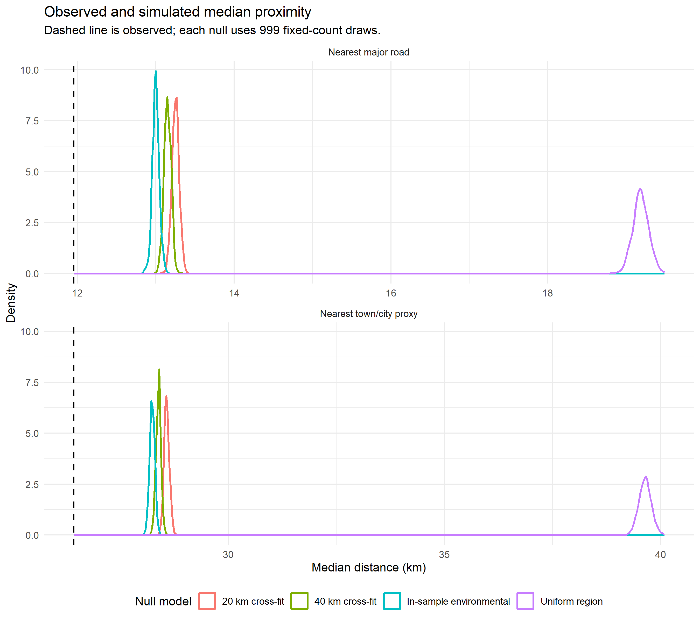
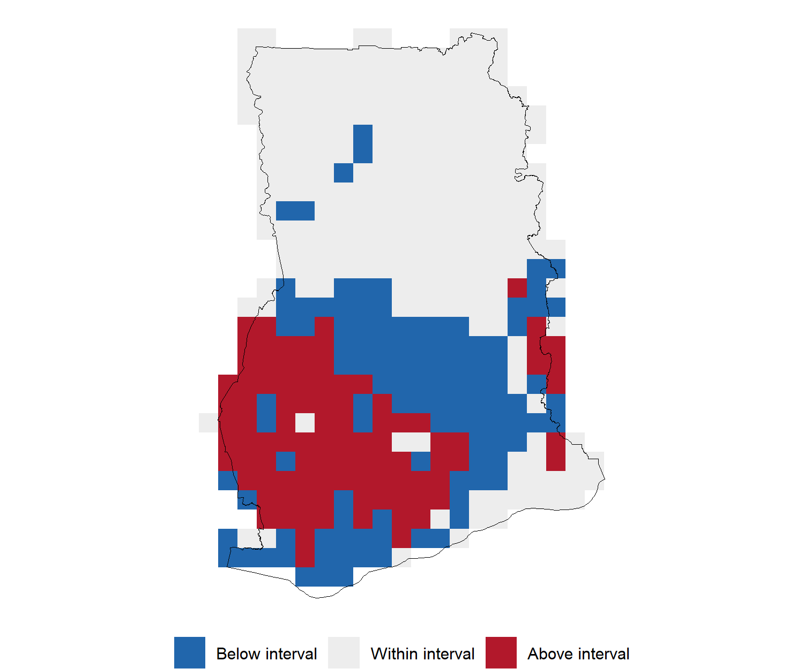

# Introduction

Cocoa is an important source of income for farming households in Ghana. Where farmers grow cocoa shapes how far beans must move to purchasing points, while the quality of rural roads affects how reliably those trips can be made. Ghana's Auditor-General documented transport difficulties in cocoa-growing areas and reviewed the Cocoa Road Improvement Programme, launched in 2015 to improve connections between producing areas, purchasing centres and ports. The programme targeted cocoa-growing areas, illustrating that the location of cocoa production can also help determine where road investments go [@ghanaaudit2023].

Agricultural geography offers a competing explanation for apparent proximity to infrastructure. Cocoa occupies a geographically concentrated belt, and roads and settlements also vary across Ghana. A comparison with uniformly distributed locations would therefore combine the geography of temperature, rainfall and elevation with the geography of access. We ask whether mapped cocoa is systematically closer to major roads than expected under a baseline that allows cell occupancy to vary with those environmental conditions. We examine proximity to towns and cities as a secondary feature of the same landscape.

{#fig-access width=80%}

@fig-access shows that mapped cocoa is concentrated in southern and southwestern Ghana and in a narrower eastern belt. Roads and urban centres are visible within and beyond these concentrations. The overlap motivates the comparison below, in which the reference locations also concentrate where the fitted environmental model assigns higher weights.

## Related research

Ghana's system of cocoa marketing distinguishes physical access from the price received by producers. @kolavalli2017 describe a board-managed system that coordinates producer-price setting, quality control and export marketing. Even when a producer price is set centrally, farm-to-purchasing-point access can affect the time and transport needed to move beans. Urban centres may indicate broader access to population and services, but dedicated cocoa buying points may also be located in smaller communities. The nearest mapped town is therefore a secondary proxy for settlement proximity, and its relationship with farm-to-buyer travel is an empirical question.

Evidence from Ghana links transportation infrastructure to agricultural markets and the geography of production. In a comparison of two rural study areas, @acheampong2018 found that farmers in areas with improved roads used more inputs and showed greater market participation than farmers in areas with unpaved roads. Such comparisons show why road condition matters in addition to distance. The historical study by @jedwab2016 examines how colonial rail connections changed the geography of cocoa production and economic activity in Ghana. That research considers historical infrastructure investments. Our cross-sectional comparison addresses the present-day spatial association between mapped cocoa and the available mapped roads, with limited ability to establish when each feature appeared.

@kalischek2023cocoa used satellite imagery and a high-resolution cocoa map to study cocoa expansion and forest loss in Ghana and Côte d'Ivoire. That map gives the present study a consistent spatial record of classified cocoa at a scale that can be compared with roads and settlements nationwide. Aggregation to a 1 km grid makes the environmental and accessibility layers comparable, although the unit represents presence somewhere in the cell and carries no direct information on the size of an individual farm, its production or its buyer.

This study adds a Ghana-wide comparison that holds the number of mapped cocoa-positive cells fixed and varies their locations under a climate-and-elevation baseline. It evaluates a directional road-distance hypothesis and then examines the broader first-order pattern with both a distance profile and an area-based intensity surface. Together these comparisons show whether the median difference is concentrated in particular distance ranges and where the environmental baseline reproduces or misses the geography of mapped cocoa.

Our directional hypothesis is that cocoa-positive cells have a shorter median distance to a major road than patterns drawn under the environmental null. Under that null, the fixed number of occupied cells is distributed according to weights estimated from climate and elevation. Median distance to an urban centre is a secondary comparison. Both statistics examine first-order variation in occupancy across the study window.

# Data and methods

The ETH Zurich binary cocoa map [@kalischek2024cocoamap] was overlaid with WorldClim 2.1 annual mean temperature, annual precipitation and SRTM-derived elevation [@fick2017worldclim; @worldclim2021], plus roads and settlements from the Geofabrik Ghana OpenStreetMap snapshot [@geofabrik2026; @OSMcopyright]. The working boundary is the Geofabrik OSM national administrative polygon. It is provisional, not an independently validated official boundary.

The analysis uses a 1 km grid in EPSG:2136 (Accra / Ghana National Grid; Gold Coast feet). The working national polygon, the cocoa raster coverage mask and complete environmental predictors define eligibility; cells beyond the cocoa raster extent are excluded. The source product uses a 0.65 threshold for cocoa classification. Its approximately 10 m values are aggregated to 1 km, and any positive aggregate marks that cell as occupied. WorldClim inputs are resampled from 2.5 arc-minutes by bilinear interpolation. The candidate grid contains 240,294 cells, including 57,131 mapped-positive cells (23.8%). The OSM boundary geometry measures 251,021.5 km². The cocoa raster bounding box intersects 99.94% of this polygon by area; approximately 143.3 km² lies outside the bounding box. The boundary area is a geometry-derived diagnostic, not an authoritative area statistic.

For the primary environmental null, a binomial generalized additive model generated five-fold spatially cross-fitted scores from smooth terms for mean annual temperature, log-transformed annual precipitation and elevation. Each held-out fold was scored by a model trained on the other four. Whole spatial blocks were grouped into five folds; 20 km blocks are primary, with 40 km as a sensitivity. Road and town distances were excluded as predictors. Each of four nulls generated 999 fixed-count (57,131), no-replacement patterns: 20 km cross-fit, 40 km cross-fit, in-sample environmental GAM, and uniform sampling across eligible candidate cells. The analysis uses 6,229 OSM motorway, trunk, primary and secondary line features and 577 mapped city, town and national-capital points. The urban-centre points serve as a settlement proxy; these are not verified cocoa-buying markets.

The primary statistic is the median Euclidean distance to a major road; median distance to an urban-centre proxy is secondary. Lower-tail Monte Carlo p-values use `(1 + number of simulated statistics <= observed) / 1000`. An exploratory functional diagnostic compares the observed positive-cell share with simulated shares across fixed distance bands (0–5, 5–10, 10–20, 20–50 and over 50 km). Its intervals are pointwise, not simultaneous.

## First-order spatial intensity comparison

First-order intensity describes how the expected number of occupied cells per unit area varies with location. For the road profile, the locations are grouped by distance to the nearest major road. Within each band, the estimated intensity is the number of cocoa-positive cells divided by the area of eligible 1 km cells in that band. This adjustment matters because distance bands differ substantially in available area. Each simulated pattern is evaluated with the same distance bands and denominator. The urban-centre profile applies the same calculation to a separate distance surface. This compares occupancy along an accessibility gradient without using distances between cocoa locations.

We also estimate a conventional area-based quadrat intensity surface over a fixed 25 km grid aligned to the Ghana National Grid. Each eligible 1 km cell contributes one square kilometre of grid support to the quadrat containing its centre. Intensity is the positive-cell count divided by this eligible grid area, including at the national edge. The same estimator is applied to each of the 999 primary environmental simulations. We map the observed estimate, the simulated median estimate, and where the observed estimate lies outside the 2.5th to 97.5th percentile interval for that quadrat. The 25 km scale summarizes broad geographic departures while retaining more spatial detail than the distance profiles. Both sets of intervals are pointwise. Their visual comparisons are exploratory, and the directional median-distance statistic remains the primary Monte Carlo test.

# Results

## Median proximity and distance-binned intensity

The observed median distance is 11.96 km to a major road and 26.43 km to an urban-centre proxy. Across the 20 km cross-fitted environmental simulations, median road distance is 13.25 km (95% simulation interval 13.16–13.34 km; corrected lower-tail p = 0.001); median town/city distance is 28.58 km (28.46–28.70 km; p = 0.001). Under 40 km cross-fitting, the corresponding medians are 13.15 km (13.06–13.23 km) and 28.39 km (28.28–28.50 km), both p = 0.001. The in-sample environmental and uniform sensitivities also yield longer simulated medians than observed; exact values are in `ghana_simulation_summary.csv`.

| Null model | Statistic | Observed (km) | Simulated median (95% interval, km) | Observed / simulated | Lower-tail p |
|---|---|---:|---:|---:|---:|
| 20 km cross-fit | Major road | 11.96 | 13.25 (13.16–13.34) | 0.90 | 0.001 |
| 20 km cross-fit | Town/city | 26.43 | 28.58 (28.46–28.70) | 0.92 | 0.001 |
| 40 km cross-fit | Major road | 11.96 | 13.15 (13.06–13.23) | 0.91 | 0.001 |
| 40 km cross-fit | Town/city | 26.43 | 28.39 (28.28–28.50) | 0.93 | 0.001 |
| In-sample environmental | Major road | 11.96 | 13.00 (12.92–13.09) | 0.92 | 0.001 |
| In-sample environmental | Town/city | 26.43 | 28.24 (28.13–28.36) | 0.94 | 0.001 |
| Uniform region | Major road | 11.96 | 19.19 (19.00–19.38) | 0.62 | 0.001 |
| Uniform region | Town/city | 26.43 | 39.64 (39.37–39.93) | 0.67 | 0.001 |

{#fig-medians}

{#fig-distance-intensity}

In the first column of @fig-distance-intensity, observed positive-cell shares exceed the 20 km cross-fit simulation envelope in the 0–20 km bands and fall below it in the more distant bands. For the town/city proxy, observed shares are lower in the 0–5 km band, higher in the 5–50 km bands, and lower beyond 50 km, consistent with a shift from the most distant cells toward intermediate distances rather than a uniform increase at every distance. These pointwise band comparisons are exploratory and not a simultaneous test. The median-distance result is the pre-specified directional test. Its minimum p-value of 0.001 is the resolution of 999 draws, not evidence that the probability is zero. All results remain conditional on the cocoa map, eligible cells, boundary and environmental model.

## Geographic intensity

{#fig-occupancy}

{#fig-residual}

The 1 km maps show observed presence alongside mean simulated selection. Their cell-level residuals reveal differences within the broadly reproduced southern and eastern concentrations. The quadrat analysis below summarizes those differences across larger geographic units.

{#fig-quadrats}

{#fig-quadrat-intervals width=80%}

The two surfaces in @fig-quadrats show high occupancy across much of southern Ghana and a narrower eastern concentration. @fig-quadrat-intervals shows where those broad similarities conceal local underprediction and overprediction. Across 440 quadrats with eligible cells, 97 observed intensities were above their pointwise intervals, 112 were below, and 231 fell within the intervals. This spread indicates substantial local mismatch despite the broad agreement. In 29 quadrats, fewer than 100 of the possible 625 square kilometres were eligible, so those estimates reflect relatively small areas. The number of departures is descriptive because the intervals cover one location at a time. Spatial departures could reflect missing environmental or land-use variables, classification error, or limitations of the fitted environmental model.

# Environmental model validity

The pooled out-of-fold AUCs are 0.934 (20 km) and 0.934 (40 km), while mean AUC across folds with both classes is 0.815 and 0.819, respectively. In both block-size designs, one held-out fold has no positive cells, so its AUC is undefined; the remaining fold AUC ranges are 0.463–0.976 and 0.458–0.987. Pooled scores combine predictions from different fold-specific fits and should not be read as a stable measure of national predictive performance. The strong between-fold variation and near-separation in some folds make the environmental scores an uncertain null model, despite finite simulated weights.

In the primary 20 km design, the weakest evaluable fold contains 37,453 of the 57,131 mapped cocoa-positive cells (65.6%). It has AUC 0.463 and a Brier score of 0.222, compared with a pooled Brier score of 0.089. The Brier score is the mean squared error of predicted probabilities, with lower values indicating smaller errors. The 42,313-cell fold with no mapped positives contributes many easy negatives to the pooled ranking. As a result, the pooled AUC can capture broad separation between regions even when the model ranks locations poorly within the main cocoa-growing area. An absence-only fold still informs the assessment of false positives there.

The similar distance results under 20 km and 40 km blocks establish sensitivity to those two choices. Their fold diagnostics show that both designs face the same geographic imbalance. The simulation intervals condition on the resulting weights, so they can be narrow even when the weights themselves are uncertain. A useful follow-up would compare geographically coherent, buffered folds with more balanced positive counts, inspect calibration in the cocoa belt separately, and rerun the simulations across credible alternative environmental fits.

# Limitations and next steps

- The project owner instructed that ETH raster NaN be interpreted as no cocoa only within the raster footprint. ETH metadata labels NaN as nodata and does not resolve its meaning; this remains an assumption that may misclassify unknown cells.
- The source raster footprint is not identical to Ghana's boundary, and the area calculation relies on a provisional OSM polygon. Obtain an independently validated boundary and verify the source coverage before making definitive national claims.
- No independent land-cover/land-use mask excludes water, settlements or other unsuitable areas. A uniform-region comparison is a sensitivity, not a valid environmental control.
- The ETH map represents mapped cocoa rather than a farm census. Detection or classification errors can affect both the outcome and the learned environmental weights.
- WorldClim climate normals are for 1970–2000 and coarser than the 1 km analysis grid. OSM roads are a later snapshot; OSM places are incomplete urban-centre proxies, not purchasing markets.
- Fold allocation is geographically imbalanced, including one held-out fold without positive cells at each block size. The GAM also produced warnings about fitted probabilities near zero or one. Re-design cross-validation and assess model-fitting uncertainty before relying on the environmental null.
- Distances are Euclidean proximity, not network travel time. No causal inference or second-order clustering analysis is performed.

The next step is to verify source-raster NaN semantics and the working boundary, then use a vetted land-cover mask to define eligible land. After that, reassess calibration with alternative spatial folds and test whether the proximity gaps persist under those revised weights. Verified purchasing sites and historical road-network data would support a subsequent comparison using network travel times. The current outputs support a provisional Ghana-wide first-order analysis, not a final validated market-access estimate.

# References

::: {#refs}
:::
